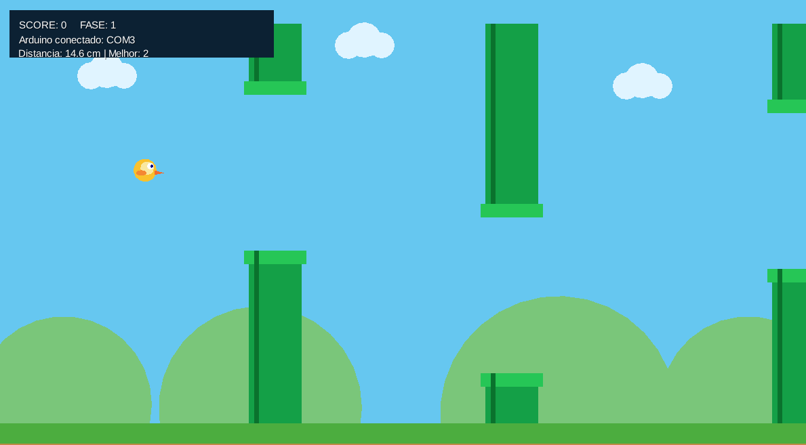
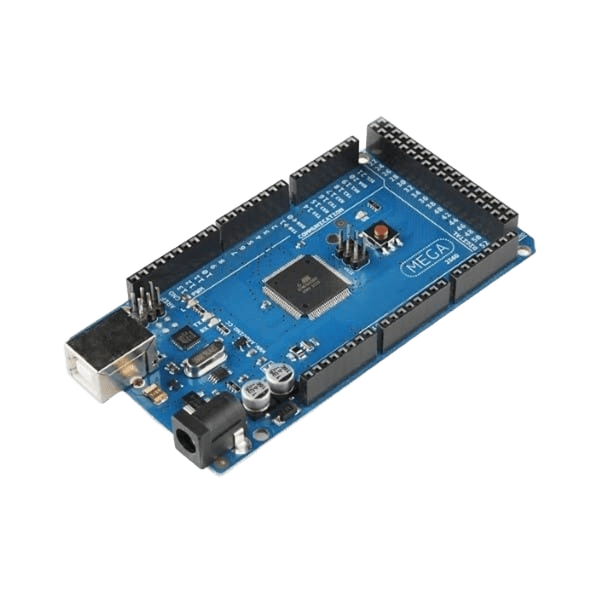
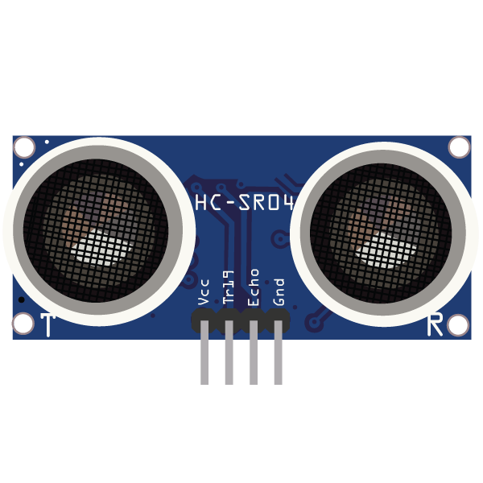

# Flappy Rehab — libGDX + Arduino HC-SR04

Projeto final de jogo 2D para reabilitação de pessoas com problemas motores inspirado na mecânica de jogos de voo lateral, com personagem original desenhado por formas simples. O jogador controla a altura com a distância da mão ao sensor ultrassônico HC-SR04.

<div align="center">
  
</div>

Aluno: Danilo Gigliotti RA: 10443431  
## Requisitos
- JDK 17
- Conexão com a internet na primeira compilação (para baixar dependências Gradle)
- Arduino MEGA e sensor HC-SR04 para o controle físico
- Windows: a porta serial costuma aparecer como `COM3`


<div align="center">
  
  
</div>

## Abrir no VS Code
1. Extraia o ZIP.
2. Abra a pasta `FlappyRehab` no VS Code.
3. Abra um terminal nessa pasta.
4. Execute:
   - Windows: `gradlew.bat :lwjgl3:run`
   - macOS/Linux: `./gradlew :lwjgl3:run`

Este pacote inclui os arquivos Gradle do projeto, mas não inclui o wrapper Gradle binário (`gradle-wrapper.jar`). Se a pasta não tiver `gradlew.bat`/`gradlew`, execute com Gradle instalado (`gradle :lwjgl3:run`) ou crie o wrapper usando `gradle wrapper`.

## Controles de desenvolvimento
- ENTER: iniciar / reiniciar
- W ou seta para cima: subir temporariamente
- S ou seta para baixo: descer temporariamente
- P ou ESC: pausar / continuar
- ENTER no menu de pausa: reiniciar

O controle por teclado é um modo de teste para desenvolver o jogo antes de conectar o hardware. Para a apresentação final, utilize o sensor físico se esse for o requisito do professor.

## Conectar o Arduino
1. Monte o circuito conforme a seção abaixo.
2. Envie o sketch `arduino/FlappyRehabSensor/FlappyRehabSensor.ino` para o Arduino.
3. Feche o Monitor Serial da IDE Arduino (somente um programa pode abrir a porta serial por vez).
4. Identifique a porta COM do Arduino no Gerenciador de Dispositivos.
5. Execute, por exemplo, no Windows:
   `gradlew.bat :lwjgl3:run -Dserial.port=COM3`

   Observação: propriedades de sistema Java precisam chegar à JVM que executa a aplicação. Se a propriedade acima não for repassada pelo Gradle à aplicação na sua configuração, execute a aplicação com a configuração de execução do VS Code ou ajuste `lwjgl3/build.gradle` para passar `System.getProperty("serial.port")` como JVM argument. Uma forma direta é acrescentar ao bloco `run` do Gradle:
   ```
   tasks.named('run', JavaExec) {
       if (System.getProperty('serial.port') != null) {
           systemProperty 'serial.port', System.getProperty('serial.port')
       }
   }
   ```
   e executar `gradlew.bat -Dserial.port=COM3 :lwjgl3:run`.

6. Ajuste no código `FlappyRehabGame.java` os limites `distanceMin` e `distanceMax` para a distância confortável que o jogador consegue alcançar.

## Circuito HC-SR04
| HC-SR04 | Arduino UNO |
|---|---|
| VCC | 5V |
| GND | GND |
| TRIG | D9 |
| ECHO | D10 |

Não conecte o ECHO a uma tensão acima de 5V no Arduino UNO. Use o sensor e o circuito em uma superfície estável.

## Como o controle funciona
- Distância maior = alvo de altura mais alto.
- Distância menor = alvo de altura mais baixo.
- As leituras são suavizadas para reduzir tremores.
- Fase 1: 0–4 pontos; fase 2: 5–11; fase 3: 12+ pontos.
- Métricas visíveis na tela: pontuação, fase e última distância recebida.

## Observações
- O projeto registra métricas simples durante a partida; não grava relatórios persistentes em arquivo.
- O código foi preparado como base inicial e deve ser compilado/testado no ambiente local. A primeira execução precisa baixar dependências.
